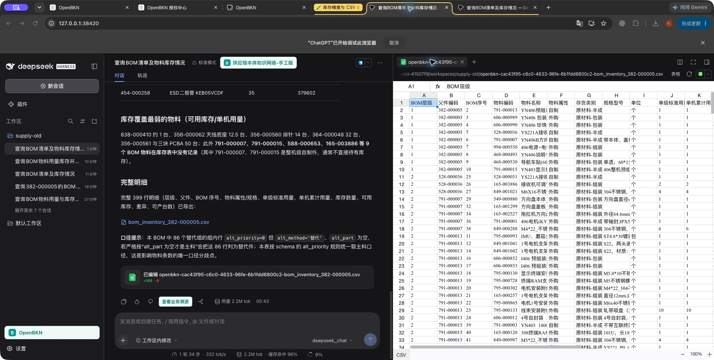
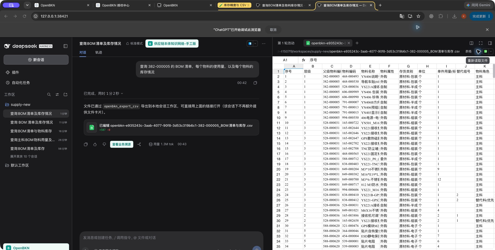

# 本地 -18：库存精度与 CSV 交付复验

检查日期：2026-10-20，Asia/Taipei（机器日志为 2026-10-19 UTC）。仅使用本机正式社区平台 `https://192.168.50.129` / `kind-bkn-test-015-lan`。未连接历史 50.28，未提交、推送、运行远端 CI 或升级用户安装的 DSH。

**两项定向问题已在两版真实 Mac npm CLI web 宿主复验通过：主料库存小数保留，生成的 CSV 已转存到当前 DSH 工作区并实际打开。完整 BOM/G6 问答仍不通过，不能据此触发最终同步或 CI。**

## 固定本地产物

| 项目 | 实际身份 |
|---|---|
| 分支 / HEAD | `feat/021-localization-login` / `933b0ab251c75461ece1ada6145a9487e7eb04d1`，本轮修改未提交 |
| 插件 | `0.2.0-rc.2-openbkn.0.2.0-18`，本地未发布包 |
| tgz | `release/local-18/openbkn-dsh-business-context-0.2.0-rc.2-openbkn.0.2.0-18.tgz`，227211 bytes |
| SHA-256 | `e9ffa895affb40a3b5d5c75d0488d5f148afdd68168145e0d86304d2e96abeca` |
| 宿主 | 官方 npm `0.2.0-rc.2` / `0.2.1-rc.2`，相同 tgz；分别固定 Cordis `4.0.4` / `4.0.5`、Schemastery `3.18.4` / `3.18.5` |
| 平台 / CLI | 官方 Foundry `v0.2.0` / peeled `81d5752826f3b3f3f72f3ad4cb1e22d45e99ab4b`；正式 npm CLI `0.2.0` |
| 实际模型 | 既有 `deepseek_chat` 配置，响应中的实际模型为 `deepseek-flash`；未更换模型或配置 |

见 [产物身份](candidate.json)、[安装文件对照](installed-artifact-check.json)、[上游发布复核](upstream-release-refresh.json)。两版实际安装的 80 个文件与该包对照通过；`package.json` 按 JSON 内容比较，其余文件按字节比较。旧版生成器和补丁 verify 通过。-15、-16、-17 的中间包留在本地，不能替代 -18 的结果；最新远端候选仍是此前的 -12。

## 已定位的原因与实现边界

1. 平台库存源字段为 DOUBLE，查询返回的小数仍在。此前旧模型回答自行整数化；本轮 -15 又复现 Python `"%g" % value` 的默认六位有效数字格式，使 `589001.624` 变为 `589002`。独立核对该文件时有 17 个主料用量/库存检查值不符，见 [原始失败检查](historical-15-csv-precision-failure.json)。通用指引现同时约束回答和 CSV 序列化，要求原始数值字符串或完整精度，明确避免默认 `:g` / `%g`。这不是数值校正器，插件不重算或改写模型输出。
2. 原 CSV 仅存在于平台 Conversation 的 Sandbox，宿主 `present` 无法读取该远端文件。新增受会话约束的 `openbkn_export_csv`：通过同一受管 `run_code` 固定只读程序读取当前 Conversation 的已有 CSV，校验大小、UTF-8、摘要和字节后，使用原生文件服务在当前 DSH 工作区新建文件，并读回确认完全一致。文件最大 512 KiB，不覆盖旧文件；平台输出不完整时拒绝，不伪称成功。Host read/grep/present 没有开放。
3. -17 的真实旧宿主请求目录里没有导出工具。原因是官方 `0.2.0-rc.2` 没有 `workingDirectory` 服务，工作区位于不可变的 `Session.header.cwd`；新版才有该服务。先前受控测试人为提供了新服务，覆盖不足。更新后的无该服务探针使旧包失败，见 [失败重现](old-native-directory-before.txt)。-18 改为使用各宿主实际提供的原生目录合同；不使用服务端 `process.cwd()` 兜底。两版真实请求目录现均包含导出工具。

导出要求调用 Agent 本身、绑定 KN 以及当前 open Interaction 的身份一致；只读 Session、错误/缺失 KN/context、跨会话、路径逃逸和不支持的 Host 工具均拒绝。远端读取拒绝符号链接和特殊文件，限制在当前 Conversation 目录。新工具只搬运文件字节；未新增业务算法、答案仲裁、自动纠错回合或 DSH 日志写入。

正式 `run_code` 的 inline-PTC schema 不在纯 Go 源投影中；新探针使用单独记录来源和摘要的现场 schema fixture，未伪造空 schema。平台脚本内的已发布函数面仍由 OpenBKN 管理；本次“拒绝不得 dispatch”的断言指插件收到的顶层工具调用，不声称插件改写了平台的脚本函数目录。

## 自动验证

| 层次 | 本轮结果 |
|---|---|
| 旧依赖基线 | 598 tests：597 pass、0 fail、1 Windows 专属 skip；类型通过 |
| 新依赖基线 | 598 tests：597 pass、0 fail、1 Windows 专属 skip；类型通过 |
| 仓库与独立评测器 | 73 pass |
| 包审计 | 80 files，通过 |
| 同包双宿主 | 各六组受控检查通过：正式采集开/关、旧合同、CSV 导出、原生输出不改写、Remote |
| 新 CSV 边界探针 | 两版各验证采集开/关；旧版不提供新目录服务，新版服务路径覆盖初始 header 路径；权限拒绝、错误摘要、字节保留、新路径和结束后拒绝均通过 |

见 [测试汇总](tests-summary.json)、[同包双宿主](controlled-hosts.json)、[旧版导出探针](csv-export-0.2.0-rc.2.json)、[新版导出探针](csv-export-0.2.1-rc.2.json)。这些是受控官方 ToolRuntime 验证，平台响应和文件端口是 fixture，不替代下述实平台、真实文件和 UI。

## 原始合同问题的实际运行

两版均在新的独立 Session 中只提交一次原始问题：

> 查询 382-000005 的 BOM 清单，每个物料的使用量，以及每个物料的库存情况

没有追加操作员纠正问题，也没有改写答案或 CSV。两回合均 completed，各有一次 start、一次 finish 和一次成功的 `openbkn_export_csv`。仍保留脚本错误与 Host 工具拒绝，不能写成无异常执行。见 [身份与工具目录摘要](real-model-summary.json)。

| 项目 | DSH 0.2.0-rc.2 | DSH 0.2.1-rc.2 |
|---|---|---|
| Session | `session-9a8f6ab5-fe58-4f85-b2b7-2f815d74473d` | `session-ab7a552d-4877-474d-8dd3-485ff237dd11` |
| CSV 原始行数 | 399，均为主料 | 506，角色列区分 399 主料与 107 替代条 |
| 本次逐项检查范围 | 399 主料行 / 333 物料 | 明确选择角色为主料的 399 行 / 333 物料 |
| 主料行身份 / 单级用量 | 全部与源 SQL 一致 | 全部与源 SQL 一致 |
| 库存核对 | 全仓可用、实存、预留；累计用量列另核对 | 全仓可用、实存、生产可用七仓、记录数 |
| 含小数库存 | 11 种物料均保留精度 | 11 种物料均保留精度 |
| 差异 | 0 | 0 |
| 文件大小 | 60351 bytes | 107887 bytes |
| 文件 SHA-256 | `80f9822aa26932d2865aed4923bf120c7fd28a49d83b320e6c791c220e3be798` | `017bc8e7cbc73c4f6a45e6a3c095112e1f86f5f1dd504499dfddbba73f6f2b88` |
| 实际打开 | 回答中的 CSV 链接 → 内置表格 | 本轮改动 → 在侧边栏打开文件 → 内置表格 |

独立 SQL 直接按物料编码聚合源表，不沿会放大库存的 BOM 联接求和。DOUBLE 独立加总允许 `1e-8` 绝对误差以忽略二进制浮点末位差，不能接受整数化或默认六位有效数字丢失。当前数据中具有主料子件的所有祖先用量均为 1，先独立验证这一条件，再以分组 SUM 核对累计用量；不把 breadth-first `seq_no` 当深度遍历路径。

见 [旧 CSV 检查](csv-sql-check-old.json)、[新 CSV 主料检查](csv-sql-check-new.json)。新版额外替代条的全部字段、旧版额外派生列和自然语言不包含在上述“0 差异”的范围中。两个文件打开后再次计算摘要，与导出工具返回的摘要仍相同，见 [文件与 UI 复验](ui-file-check.json)。未执行 Excel/WPS/Numbers 的原生打开，不沿用模型声称“Excel 双击可用”作为证明。

## 完整问答仍未通过

- 旧版开头使用 400 行 / 334 种，未明确标注含根，末尾又使用去根 399 行，统计口径仍混淆。它另外生成了未请求的 `累计需求-可用库存` 列，其中 389 行与列名所表达的差值符号相反；例如需求 1、库存 1000，写入 999。原始模型文件没有被修正。这是额外派生列问题，不是主料库存被取整。
- 新版最终回答仅说“可直接用上面的链接打开”，没有重述 BOM、范围和文件链接。文件确实存在，可以通过原生本轮改动卡进入表格，已实际操作；这不能充当独立可读、完整的最终业务回答。
- 当前仅对受影响的 BOM 问题重新评分，其余 G6 项明确为 `not-run`；不复用历史包的回答作为新候选证据。独立评测新增精度与实际文件打开条件，两版 BOM 整题均 FAIL，见 [旧版评分](eval-0.2.0-rc.2.md)、[新版评分](eval-0.2.1-rc.2.md) 和 [额外异常](additional-anomalies.json)。评分是基于证据的人工逐项判定，脚本只校验输入与生成报告，不是自动业务事实裁判。

## 平台、保留与剩余门槛

同一回合标准 Interaction 与操作读取均为 200，返回 completed，分别读取 44 / 52 条操作；采集为 enabled。原生业务 detail/explanations 仍是当前正式社区部署的 404，未安装企业扩展，非空业务解释验收继续开放。见 [本轮读取](live-readback.json)，根因沿用此前源码和 Service/HTTPS 双路径证据，不把所有 404 推断为许可问题。

12 张供应链原表 78635 行的摘要均未变；KN、模型、本体、工具、Skill 和绑定的选定业务配置与上轮本体修正后的基线一致。只新增正常 Trace/会话及测试文件，见 [保留检查](preservation-check.json)。本轮没有改平台业务函数或 Skill。正式应用仍是 16 个 0.2.0 Chart + 1 个样例 0.1.0、应用/资源 namespace 27 个 Running Pod 全 Ready；集群全部 namespace 的口径另为 21 个 Helm release / 37 个 Ready Pod，见 [现场健康](final-health.json)。

完整 G6、Mac Desktop、原生 Windows 两种形态、非空原生业务解释、B1 和其余人工/发布门槛仍开放。缺口未关闭前保持用户明确要求的不推送、不跑 CI；本地 -18 不是固定远端验收候选。当前无需用户重新登录或完成原生目录选择。
