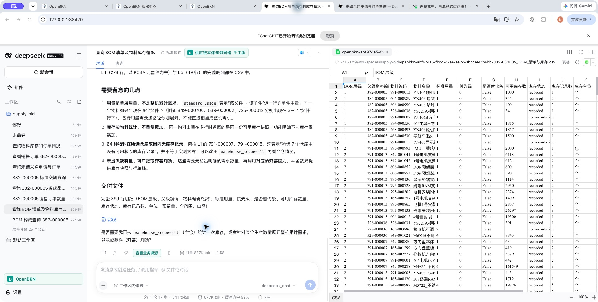
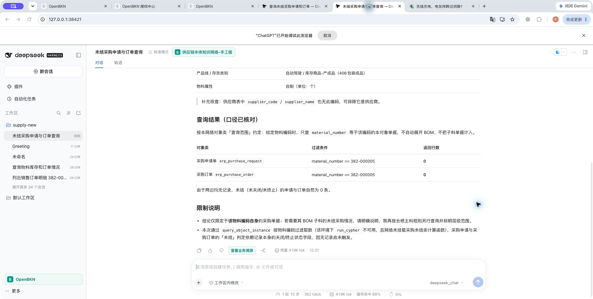

# 本地 -23 开发与完整 G6 复验（2026-10-20）

本轮完成了统计范围、Function 参数合同和本地文件交付的修正；**完整 BOM/G6 仍未通过，不能提交最终远端 build-only CI**。采购范围经用户确认后，两版新会话均按产品本身返回 PR 0、PO 0。全部开发和验证仅在本机进行，没有新 commit、push、CI、PR、tag 或发布。

## 产物与环境

| 项目 | 本轮实际身份 |
|---|---|
| 插件本地版本 | `0.2.0-rc.2-openbkn.0.2.0-23`，未发布 |
| 冻结 tgz | `release/local-23/openbkn-dsh-business-context-0.2.0-rc.2-openbkn.0.2.0-23.tgz`，228057 bytes |
| SHA-256 | `fd2b0126d66e5f7bad4241516d81724b03c0089552b6d3036b77364fc8e7368e` |
| 构建基础 | `feat/021-localization-login` / `933b0ab251c75461ece1ada6145a9487e7eb04d1` 加保留的本地修改 |
| 正式平台 | 本机 `https://192.168.50.129`，官方 Community `v0.2.0` / `81d5752826f3b3f3f72f3ad4cb1e22d45e99ab4b`，CLI `0.2.0` |
| Kubernetes | `kind-bkn-test-015-lan`；未使用历史 `50.28` |
| 真实宿主 | macOS arm64，官方 npm CLI web `0.2.0-rc.2` 与 `0.2.1-rc.2`；没有给用户全局 DSH 打补丁或升级 |
| 模型身份 | 配置别名 `openbkn-acceptance/deepseek_chat`，原生响应实际记录为 `deepseek-flash` |
| 远端候选 | 仍是 `933b0ab` / `-12` / build-only run `39268135924`；本轮 -23 不是固定 CI 候选 |

两版实际安装包各80文件与冻结tgz一致，`package.json`按JSON语义比较，其余文件逐字节一致。真实完整CLI依赖闭包分别为278个旧版、295个新版DSH包，均未混版，Cordis分别单一4.0.4/4.0.5。受控最小运行集合和真实完整CLI闭包分别核对，不能相互替代。[产物核对](installed-artifact-check.json)、[旧版闭包](runtime-closure-0.2.0-rc.2.json)、[新版闭包](runtime-closure-0.2.1-rc.2.json)。

2026-10-20 03:07Z 已只读刷新两个上游：DSH最新公开tag为`dsh-v0.2.1-rc.2`，OpenBKN最新正式release为`v0.2.0`；另比较了平台主线相对支持基线的变更。它们不构成升级授权，实际支持和运行的仍是上述固定版本。[上游记录](upstream-refresh.json)。

## 已完成的修正

- **统计范围由业务能力直接披露。** BOM与分层库存返回`count_scopes.components`、`selected_depth`、`source_rows`，各自带含根/替代/深度、行数、不同物料数及`by_level`。主料仅由`alt_priority=0`判定，`alt_method`不参与。去根主料399行/333种，L1至L5行数9/23/40/278/49；去根含替代506/407；原始含根含替代507/408；含根主料400/334。
- **库存和单耗口径。** 保留小数，汇总使用`math.fsum`；明确生产可用仓与全仓范围、可用状态、预留另列不扣减、不含在途。无记录返回空值及记录数/状态，区别于测得0。`standard_usage`是父子行单耗，不当作累计需求；没有需求数量时不据此宣称短缺或瓶颈。
- **正式Function发现到执行。** 实平台发现元数据包含OpenAPI `request_body`，但`execute_tool.arguments`直接接收业务属性，不能再包一层`request_body`。缺少合法product在查询前拒绝；同时检查HTTP、body.exit_code及业务result。保留真实失败和回归，不把HTTP200计为执行成功。
- **可打开的最终文件。** 受支持导出只读取当前Conversation中已有UTF-8 CSV，验证大小、SHA和落盘字节，返回已验证路径及转义的工作区相对`markdown_link`。旧宿主用不可变Session header cwd，新宿主优先原生目录服务。最终回答需要自行包含真实链接及交付范围。
- **拒绝后的恢复说明。** -22旧版曾声称没有导出能力，实际请求目录已包含该工具。-23的Host/raw-query拒绝说明现在明确指出已注册的`openbkn_export_csv`仍可用。Host读文件、shell、raw query仍被拒绝；没有放宽白名单。
- **采购范围落实在业务对象层。** 用户确认只查产品本身。样例和本机PR/PO对象说明明确按`material_number`等值查本对象，不自动展开BOM。只改comment/update_time，未改schema、数据源、对象身份或绑定。

插件没有增加业务公式、答案仲裁、固定报告模板或自动纠正回合。业务计算在样例Function/对象定义中，原生自然语言答案保持原样。-18至-22原始失败、原始CSV和源调用仍保留；不把后续成功文件替换到先前失败会话。

## 验证层次

| 层次 | 结果与边界 |
|---|---|
| 两版源码 | 各600项：599 pass、0 fail、1 Windows-only skip；类型检查通过 |
| 仓库与评测器 | 73 pass；采购范围更新后评测器7项再验通过，非布尔输入拒绝和not-run分母规则均保留 |
| 样例业务源码 | 200 pass；最新PR/PO说明调整后相关合同12项通过；用户原有preflight.py摘要未变 |
| 包与生成器 | 80文件审计通过；保留的旧生成器补丁verify通过 |
| 同包双宿主受控运行 | 正式采集开、正式采集关、旧合同、CSV导出、原生回答、Remote共六组，各宿主均通过；使用受控平台和脚本模型，不等于真实问答通过 |
| 实平台schema | 25个工具：23个与正式源码schema匹配，2个内联PTC；排除项继续受守卫限制，未全量放行 |
| 实Function与SQL | 两种库存范围均按100/100/100/99分页，399行/333物料逐行核对通过；30组逐层范围与独立SQL一致 |
| 精度 | 全仓11种小数物料核对无差异；本轮生产可用仓范围实际没有小数，不声称当前生产仓CSV覆盖这11项 |
| 原始文件实际打开 | 旧版BOM构成CSV、旧版BOM库存CSV、新版先前采购CSV均从各自最终回答链接进入原生表格，查看后原字节摘要未变；新版采购CSV属于已废弃的BOM扩展范围，不能作为产品本身采购通过证据 |
| 实Interaction读取 | 18个真实模型Interaction及operations全部200，采集有效；每个的可选原生业务detail/explanations为404 |
| 人工/产品验收 | 仅记录上述实际查看；完整Desktop/Windows、完整人工交互及其它发布门槛未完成 |

[验证摘要](verification-summary.json)、[受控矩阵](controlled-hosts-report.json)、[发现到执行](discovery-execution-check.json)、[逐层范围](published-level-scopes-check.json)、[库存SQL核对](published-inventory-sql-check.json)、[文件打开与摘要](delivered-file-open-check.json)、[实际读取](live-readback.json)。

旧版完整库存CSV的399条父子行、单耗、可用库存、预留、记录数和无记录空值均匹配独立SQL。BOM构成CSV全部9个来源字段亦匹配；比较显式统一了平台表示：SQL占位替代组0与Function空串、SQL本地日期时间与平台带时区ISO。原文件未改写，最初未做表示统一时的差异记录留在受保护release目录。[库存CSV检查](csv-check-old.json)、[构成CSV检查](bom-structure-csv-check-old.json)。

## G6 原问题结果

题集SHA-256：`1c3892461dd541900e446636f969e92044ff6c6721e9f63b4d5267d41fce96e8`。题目原文保持不变，按每项事实/禁止项人工逐条判定，以独立SQL和真实UI为依据；没有模型代打分、答案改写或CSV修补。采购使用对象说明更新后的新会话，其余使用本轮各题已记录的原会话；不是挑选同包历史最好答案。

| G6 项 | 旧宿主 | 新宿主 | 实际发现 |
|---|---|---|---|
| 销售订单数量/状态 | FAIL | FAIL | 均正确得到40、已确认；最终答案未列出冻结标准要求的两个完整单号区间 |
| 成品仓库存 | PASS | FAIL | 3个成品仓325/127/82=534均正确；新版额外把全仓816误写为716 |
| 标准交期 | PASS | PASS | 自制件生产固定提前期1天，与物料数据一致 |
| BOM构成 | PASS | FAIL | 同范围逐层统计现正确；新版脚注仍把`include_substitute=true`的去根506写成含根原始507 |
| 完整BOM/单耗/库存 | FAIL | FAIL | 旧版完整399行文件正确，但正文把588-000620→972-000712的真实L5误写L4；新版只给L1/L2共32行，无完整CSV且未明确仓范围 |
| 未结采购申请/订单 | PASS | PASS | 最新确认范围下，均明确只查产品本身，分别PR0、PO0，没有把子料采购加入结果 |
| 销售订单明细 | PASS | FAIL | 旧版40条逐字段与SQL一致；新版按订单/合同片段检索，只找到SO0000005并错称总共1条，漏39条，未做产品字段精确查询 |
| 不存在的物料 | PASS | PASS | 明确无记录，不编造非零业务数量 |
| 无效token | PASS | PASS | 隔离无效登录，HTTP401与重新登录提示清楚，模型/业务工具调用为0 |
| 平台不可连接 | PASS | PASS | 隔离连接故障可见，模型/业务工具调用为0；故障移除后原Session恢复 |
| 无该KN权限 | NOT-RUN | NOT-RUN | 用户回复低权限独立CLI配置“暂缺”；管理员或无效token不代替权限负例 |

旧版：正例5/7、负例3/3，总计8/10已测；新版：正例2/7、负例3/3，总计5/10已测。各1项未执行，不计入已测分母，也不记为通过。评测器进程退出0仅表示完成记录，不能据此声称G6通过。[旧版逐项](G6-0.2.0-rc.2.md)、[新版逐项](G6-0.2.1-rc.2.md)、[判定依据](g6-judgments.json)。

采购新会话：旧`session-a0c52ee3-99ec-42a2-a49d-39d4d5318867`，新`session-93a2b72b-80f4-4ea5-99c9-e94a68f815bc`。旧版仍有冗余诊断扫描、三次被拒绝run_cypher及“未重试”的错误过程描述；新版有一次被拒绝run_cypher。最终采购范围与0/0四项答案标准通过，过程异常不因此删除。此前旧`session-fbc5591f-62a5-4240-b3c2-a0a5d3dce177`、新`session-969fb6dd-eb45-4c8a-a67f-6c06ed283af2`都自动扩展过BOM，按确认规则保留为范围失败，不进入当前采购通过结论。

所有18份正常业务最终原文和4份负例占位均按宿主/Session保存于[answers](answers/)。旧版销售明细答案的多余DSML尾串原样保留为展示异常。原始native Session、请求目录、完整tool结果与失败记录留在本机受保护release目录；此处仅含字段白名单摘录。[当前会话索引](latest-completed-cases.json)、[全部本轮索引](real-model-summary.json)、[销售明细核对](sales-answer-sql-check.json)。

## 负例隔离及恢复

无效token使用官方CLI的任务独立配置与合成失效签名，不撤销用户默认登录。连接负例使用任务专属HTTPS转发地址`192.168.50.129:38429`，先以有效凭据和CA校验证明正常，再仅中断代理接收的两次连接；真实平台和模型网关始终运行。最初搭建代理时的过期凭据401只记为准备阶段问题，刷新任务引用并验证健康后才开始连接故障计时。

故障移除后，两版网络列表无需重启即恢复；同一失败Session的第二个“你好”回合完成、工具调用0，证明可继续使用。这是连接恢复检查，不是业务纠正回合，也不冒充G6正例。临时别名只指向用户已批准的同一工作区，原映射保留；测试后任务profile和工作区索引逐字节恢复，代理已停止。只允许两个原有测试凭据引用刷新，其他凭据数据未变。当前默认CLI0.2.0已认证读取网络成功，**不需要用户重新登录**。[无效登录](negative-invalid-records.json)、[故障及恢复](negative-unreachable-records.json)、[最终环境](restored-environment-check.json)。

## 数据和配置保留

12张供应链原表共78635行，按批量转义文本排序后计算SHA-256，所有摘要与本体规则调整前原始业务数据基准一致。选定配置相对已授权主料规则调整后的基准，只有以下预期变化：

- 两个既有BOM/分层库存Function的代码和使用说明，工具身份不变；归档其他文件保留。
- BOM、PR、PO三个对象类的comment及update_time，schema、键、数据源和其它字段保留。
- 一个新增只读分层库存能力绑定`01a15750-6f6d-7b7b-8ffc-85a0d81cc89c`，原BOM绑定保持不变。

其它所选KN、模型、对象、关系、Skill和已有绑定无额外变化。用户原有`tools/preflight.py`摘要仍为`4ed2bba80f394fd13a227d44b6f2cdf5262348b3b29cc89e479cf19229cf2031`。每项平台修改都有本机私有before/request/after/rollback；不复制SQL行内容、凭据或bootstrap链接到公开证据。[原表保留](preservation-check.json)、[元数据变化](metadata-change-summary.json)、[PR/PO字段核对](purchase-object-scope-check.json)、[既有用户修改](user-change-preservation-check.json)。

## 继续开放的门槛

完整BOM交付、错误统计转述、销售明细完整性及冗余/无效调用仍需在所属业务/模型/合同层继续收敛。不得通过插件硬编码这些业务数值、给已有回合补答案、无变更反复重跑挑选成功样本，或放宽评测来消除失败。

低权限账号暂缺，独立记录为待验。Community未挂载可选企业原生业务溯源，标准Interaction成功不替代非空原生解释；继续使用Community。Mac Desktop、Windows两种形态、完整人工交互、B1有边界复现、既有SDK依赖安全决策和最终固定CI候选均保持开放。当前没有发布或最终远端构建条件，继续遵守用户的“不推送、不跑CI”。
