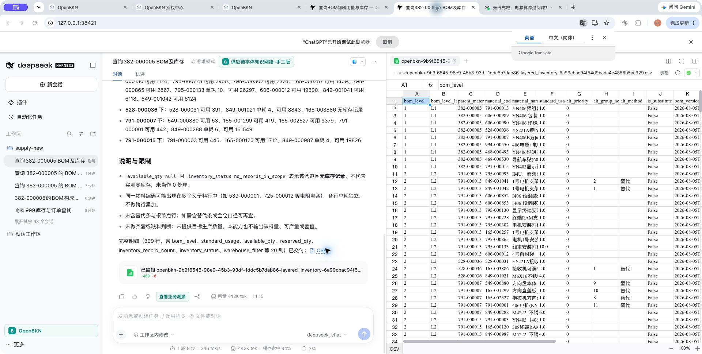
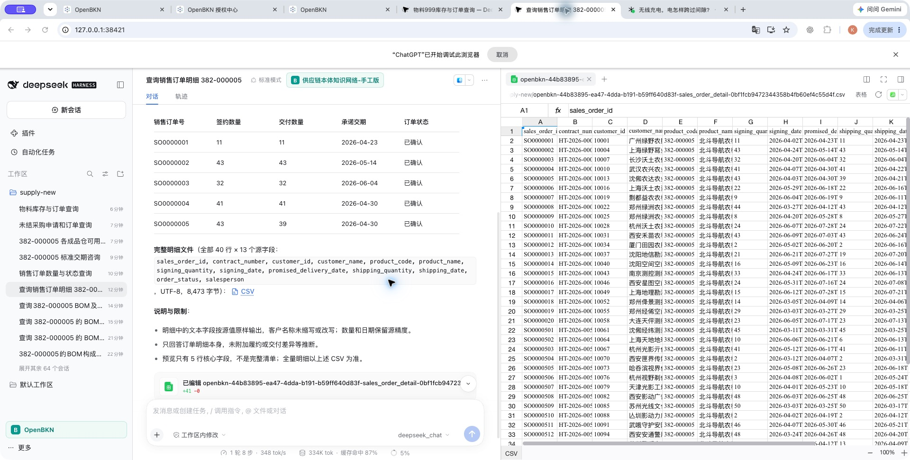

# 本地业务第 31 轮：完整 BOM/G6（同一 -23 插件，2026-10-20）

本轮解决了所属业务层的层级/统计粒度、完整 BOM/CSV 交付及销售明细获取能力；**完整验收仍未通过**。当前固定模型批次中，旧版销售明细仍误报20单并漏掉最终明细表；新版以完整40单CSV交付通过。旧版G6已测9/10、新版10/10；各1项低权限负例未测。没有新commit、push、CI、PR、tag或发布。

## 身份与边界

- “第31轮”是本地业务迭代编号；插件仍是未发布的`0.2.0-rc.2-openbkn.0.2.0-23`，228057 bytes，SHA-256 `fd2b0126d66e5f7bad4241516d81724b03c0089552b6d3036b77364fc8e7368e`。两版实际加载各80文件一致，package.json按JSON语义比较，其余逐字节一致。[当前产物核对](installed-artifact-check.json)
- 分支`feat/021-localization-login`、HEAD`933b0ab251c75461ece1ada6145a9487e7eb04d1`加保留的未提交修改。正式远端候选仍为此前-12；当前本地包不冒充固定CI候选。
- 平台仅本机`https://192.168.50.129`，官方Community`v0.2.0`/`81d5752826f3b3f3f72f3ad4cb1e22d45e99ab4b`，CLI`0.2.0`，Kubernetes context`kind-bkn-test-015-lan`。没有访问历史50.28。
- 两个实际宿主是隔离的官方Mac npm CLI web `0.2.0-rc.2`和`0.2.1-rc.2`。没有升级用户全局DSH或修改其个人配置。配置路由别名`openbkn-acceptance/deepseek_chat`，16个业务回合原生响应模型均为`deepseek-flash`。
- 本轮先前只读刷新了DSH和OpenBKN上游及增量变更；固定运行版本未自动升级。[上游记录](upstream-refresh.json)

## 已实施的业务修正

1. **分清父件与子项层级、行数与物料种数。** BOM函数按所选主料/替代、去根、深度范围计算逐层和父件分支统计，分支同时给出父层、子层和标签。BOM对象本身补齐函数入口、`material_code`去重粒度，避免把主料行数转述为去重种数。主料只由优先级0判定，alt_method不参与。
2. **完整范围由Function生成文件。** BOM/分层库存默认生成完整范围CSV及独立一级预览；未指定depth时文件含全层。默认只披露当前所选口径，含根原始审计统计显式`include_audit_scopes=true`才返回。`csv_export.columns`来自实际CSV列名，不能猜测额外字段。保留显式分页方式与审计请求。
3. **完整销售明细能力。** 新增只读“销售订单明细”，按`product_code`精确查询、校验全部分页/总数、拒绝重复单号；返回张数、状态、连续单号区间及完整源字段CSV。前5行核心字段只是预览；客户名称不缩写，数值和日期不经模型重写。[Function实测](sales-function-contract-check.json)
4. **确切编码、所问数据集和仓范围。** 新增只读“物料库存与单据记录”，要求明确`material_code`和`sources`；采购只取本编码PR/PO，不展开BOM。库存按所选仓预设复用分层库存的同一计算，直接返回逐仓值及合计。无记录为null；0条单据可证明该范围无未结项，有记录时保留源状态，不新增未确认的状态分类。[三个实平台场景](records-function-contract-check.json)
5. **业务说明对齐。** 自制件标准交期用生产固定提前期，外购件用采购固定提前期；销售查询不用销售单号/合同片段匹配产品；缺失核查不附加全网主档数量或编码区间。

这些计算与语义都在bkn-samples及本机OpenBKN对象/Function层。插件没有增加业务公式、默认答案仲裁、固定报告模板或自动纠正回合；Host/raw-query拒绝保持不变。

## 验证结果

| 层次 | 结果与实际边界 |
|---|---|
| 业务源码 | 225项通过，包含完整短页分页、缺失/重复/越界拒绝、精确编码/仓范围、精度和原始字段交付。代码冻结于第30轮；第31轮只改BOM对象说明，当前代码摘要一致 |
| 评测器 | 本轮7项通过；G6题集SHA始终`1c3892461dd541900e446636f969e92044ff6c6721e9f63b4d5267d41fce96e8`，未放宽事实/禁止项或not-run分母 |
| 未变更插件 | 沿用-23两版各599 pass/1 Windows-only skip（600 total）、类型、仓库/评测器73项、六组受控验证。没有把沿用结果记作本轮新跑；当前安装80文件另已重核 |
| 实平台Function | 明细CSV当前Conversation可读，范围/行数/摘要一致；两种仓范围及40单销售执行成功。第31轮Function代码与第30轮完全相同，代码/元数据证据注明来源轮次 |
| 两版BOM构成文件 | 各399行/333种，全部9个来源字段（含名称、父子身份、层级、单耗、角色/替代组与版本）与独立SQL一致；均从各自最终链接实际打开，原字节未变 |
| 两版完整BOM/库存文件 | 各399行/333种；BOM字段及可用库存、预留、记录数、无记录空值逐行与SQL一致。均从最终链接打开，SHA为`98ec958bd16e2ae71295c73d6b059e3166d9e9dcb7f60b9f465823ab7946b9f6`，299019 bytes |
| 库存精度 | 本批生产仓CSV没有小数。另对与当前全仓Function输出同字节的原文件重新用SQL核对，11种小数物料均无差异；这是脚本Function/文件证据，不称为本批模型UI的小数覆盖 |
| 最终正文 | 两版L1表与SQL一致，新版额外23条L2示例与已独立审计的原文件一致；无记录明确为null，未附加差值/缺料推算 |
| 新版销售文件 | 40行×13源字段、8473 bytes，SHA`d9c26b8f8cc23ca064a6ce7e859f8a90fa9417a1e739ce798238910e2e528437`；全部字段与SQL一致，从最终链接进入原生表格后摘要不变 |
| 实Interaction | 本批16个业务Interaction及operations均200、采集enabled；原生可选business-provenance detail/explanations仍404。completed只表示运行结束，不代表答案正确 |

[本机原始CSV索引](FILES.md)、[验证摘要](verification-summary.json)、[代码冻结核对](business-source-integrity-check.json)、[BOM文件核对](delivered-file-open-check.json)、[正文核对](bom-prose-sql-check.json)、[额外示例](additional-bom-prose-check.json)、[全仓精度](all-warehouse-csv-check.json)、[销售明细审计](sales-answer-sql-check.json)、[实际读取](live-readback.json)。另将新版一级预览的9项库存记录数和记录状态逐一与已独立SQL核对的原CSV比较，全部一致：[预览记录元数据](prose-record-metadata-check.json)。SQL日期/替代组的表示差异只在比较器里显式规范化；原CSV从未修改。正文比较器起初未识别“无记录（null，不代表零库存）”，误报两项；已按原句的明确缺失含义修正解析，初始误报留在私有release目录。

## G6 原题判定

本批每版8个业务原题均为冻结后的独立新Session，没有给原回合补答案。认证与连接负例来自**同一未变更-23插件**的既有隔离故障测试，明确沿用；新增业务函数不影响这两项前置守卫。没有用先前成功的销售答案替换本批失败。

| 项目 | 旧版 | 新版 |
|---|---|---|
| 销售订单数量/状态及两个单号区间 | PASS | PASS |
| 三个成品仓325/127/82，合计534 | PASS | PASS |
| 自制件生产固定提前期1天 | PASS | PASS |
| BOM构成、层级及统计范围 | PASS | PASS |
| 完整BOM/单耗/库存及可打开CSV | PASS | PASS |
| 产品本身PR0、PO0，不展开BOM | PASS | PASS |
| 销售订单明细 | **FAIL** | PASS |
| 不存在物料、无非零业务数值 | PASS | PASS |
| 无效平台token（沿用-23） | PASS | PASS |
| 平台不可连接/恢复（沿用-23） | PASS | PASS |
| 无该KN权限 | NOT-RUN | NOT-RUN |

旧版正例6/7、负例3/3，合计9/10已测；新版正例7/7、负例3/3，合计10/10已测。各1项低权限负例按用户“暂缺”未执行，不计入通过，也不以管理员或无效token替代。[旧版逐项](G6-0.2.0-rc.2.md)、[新版逐项](G6-0.2.1-rc.2.md)、[判定依据](g6-judgments.json)。评测器退出0仅表示记录完成。

**剩余旧版失败的原调用证据**：正确的“销售订单明细”能力已经被发现，入参schema及使用说明均披露；该回合没有调用execute_tool，转而请求未附产品条件的销售对象第一页（limit=100，平台返回total_count=800）。最终却声称按product_code精确过滤、完整总数20，并引用“上表20行”，最终消息里没有表或文件。独立SQL、实平台函数以及该宿主另一条数量原题均为40。系统消息中也已包含自包含最终回答及能力调用指引。这一失败不能靠改写原回答、自动补一轮或挪用另一题的正确CSV关闭。

[旧版失败最终原文](answers/0.2.0-rc.2/sales-order-detail-session-d3094f4e-6b4c-4e6d-a372-bacb36fc1d2a.md)，[新版原文](answers/0.2.1-rc.2/sales-order-detail-session-667bd486-a539-44e8-a329-5a991d285ed7.md)。16份原文均在[answers](answers/)中原样保存。

[发现/执行核对](old-sales-discovery-execution-check.json)、[原生指引存在核对](model-policy-presence-check.json)。其他已配置模型路由的独立对照已向用户询问信息；尚未得到路由前，不改模型、不把这一项记为通过。即使后续对照通过，也要与当前固定路由的失败分开。

## 保留、恢复和未完成门槛

12张业务原表共78635行，摘要与原始基准全部一致。相对已授权主料规则修正后的配置基准，仅有：两个既有BOM/分层库存Function修改、两个新增只读Function（销售/确切编码记录），六个对象说明及五个属性comment，以及三个增量只读绑定（库存、销售、确切编码记录）。原BOM绑定和其余对象/关系/模型/Skill及已有绑定保持原样。每次修改均保存私有before/request/after/rollback；未导出凭据或SQL行正文到此目录。

早期库存对象更新曾漏带logic_properties；在模型验收前已从不可变备份恢复。当前完整对象比对确认库存原有2个指标、销售原有1个指标及其它非预期字段均保留。用户已有preflight.py摘要仍为`4ed2bba80f394fd13a227d44b6f2cdf5262348b3b29cc89e479cf19229cf2031`。[原表摘要](preservation-check.json)、[变更白名单](metadata-change-summary.json)、[六个对象完整核对](object-preservation-check.json)、[既有用户修改](user-change-preservation-check.json)。

第24至30轮原始失败继续留存：旧分支少算、跨层级示例、误述记录数、主料/原始范围混用、新版漏39单、旧版三仓564及采购BOM越界等。第30轮后半还遇到任务模型引用失效（API密钥无效），平台CLI仍正常；刷新专用引用后第31轮16题均完成。失效与缓存凭据生命周期有关是推断，没有解析或公开token；它不是平台登录负例。该失败Interaction现为abandoned，标准记录可读，没有伪装为成功。[中断记录状态](model-setup-interaction-readback.json)

完整合同仍开放：旧版销售明细、低权限负例、Community不支持的非空原生业务解释、Mac Desktop/Windows矩阵、完整人工交互、B1复现、既有SDK安全决策以及最终固定CI候选。继续使用Community；标准Interaction成功不替代非空原生解释，也不把404普遍推断为许可证问题。当前不具备最终远端build-only CI条件；继续禁止推送和CI。当前默认CLI无需用户重新登录；两个任务profile与工作区索引均与故障隔离前逐字节一致，只刷新了两个既有测试凭据引用，临时故障代理已停止。[恢复检查](restored-environment-check.json)。两版重启后各一条独立“你好”控制题均完成且未出现密钥无效提示；这两题仅验证模型连接恢复，不计入16条业务原题，也不替换失败答案：[恢复控制](model-credential-restoration-check.json)。

证据目录最终的文件摘要、源码/安装产物/原CSV一致性及相对链接检查见[归档核对](closeout-validation.json)与[证据清单](public-evidence-manifest.json)。模型原文中的工作区相对CSV链接按FILES说明解释；不改写原文以适配文档目录。
