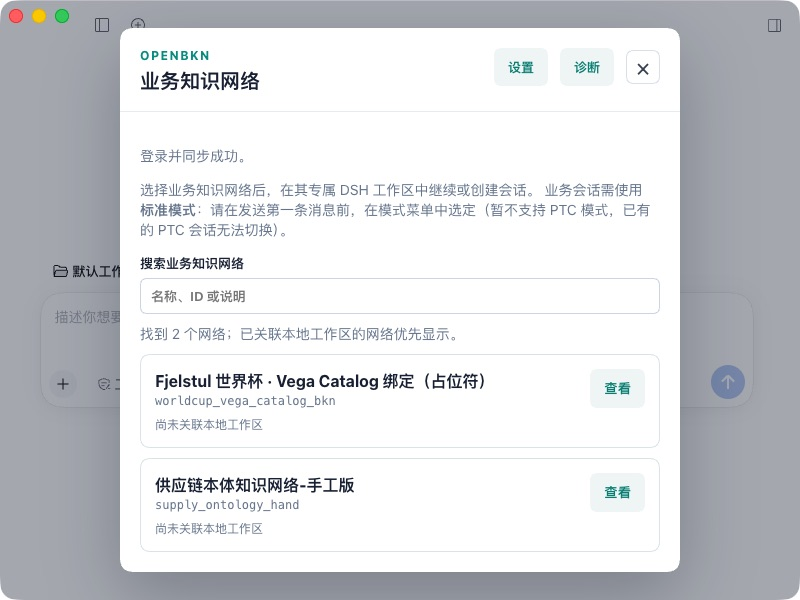

# 第32轮：安全影响、Mac Desktop 与登录取消修复

日期：2026-10-21，Asia/Taipei。**完整验收合同仍未通过。没有提交、推送或远端CI，没有升级运行平台。**

本轮查明正式0.2.0的安全影响，准备了独立本地回补镜像；在两版官方Mac Desktop发现并修复弹层焦点和登录取消进程残留。新的本地插件候选为 `0.2.0-rc.2-openbkn.0.2.0-25`，不是正式CI候选。最新远端候选仍是 `933b0ab` / -12。

## 固定身份与边界

- 插件分支 `feat/021-localization-login`，HEAD `933b0ab251c75461ece1ada6145a9487e7eb04d1`；保留此前未提交修改。
- 当前运行平台仍为官方 `v0.2.0` / `81d5752826f3b3f3f72f3ad4cb1e22d45e99ab4b`，仅使用 `https://192.168.50.129` / `kind-bkn-test-015-lan`；未修改正式源码checkout或运行Deployment镜像。
- -25 tgz SHA256：`ec33b3ff3776b28a939a12e7c8b822bfa2878e812db13edd3a0db59794a25d63`，229313字节，81个文件。两版Desktop独立profile安装的全部81文件一致，package.json按语义比较。
- Desktop 0.2.0-rc.2 是系统现有官方app的完整任务副本；0.2.1-rc.2 ZIP来自官方更新源，347777642字节，SHA512与官方feed一致；两app的严格深度签名校验通过。没有覆盖 `/Applications/DeepSeek Harness.app`。
- 每个Desktop使用自己的 `DSH_HOME`、Electron user-data和工作区。官方加载规则解析的DSH包分别280/297个，Cordis分别4.0.4/4.0.5，没有混版或多Cordis。此为安装/加载解析核对，未把磁盘元数据当成进程内存检查。

收尾再次核对上游：DSH master仍为 `687f282e8625c6b8d11ff58211a90524be2e4317`，最新release条目为 `dsh-v0.2.1-rc.2` prerelease；Foundry最新正式release仍为v0.2.0，main已到 `e47ebc0563378765cf830981ab56d55bf6b281e6`。相对本轮稍早的b36a3c4新增5个Cypher/关系属性校验和说明提交；所消费的run_cypher schema与Sandbox SDK变更为限制说明，未更改本地固定平台或四文件安全回补。没有跟随main升级pin。来源为[DSH release](https://github.com/deepseek-ai/deepseek-harness/releases/tag/dsh-v0.2.1-rc.2)、[Foundry release](https://github.com/openbkn-ai/bkn-foundry/releases/tag/v0.2.0)与[新增提交比较](https://github.com/openbkn-ai/bkn-foundry/compare/b36a3c408a04d7d5dc0831b759bab473b22dd829...e47ebc0563378765cf830981ab56d55bf6b281e6)。

## 安全影响与尚未执行的回补

正式 `run_code` 的event中包含调用者token，Sandbox的正式ORM把整个event持久化；只读聚合发现670条历史执行中395条含非空token字段、8种不同值。未读取或导出token值，未验证其有效性、未测试越权，也未证明外泄。现场Python源码摘要与正式tag一致。operator另有event span属性和完整request_params错误记录路径；当前trace.enabled=false不能消除数据库问题。

本地仅回补四个文件，构建两个派生镜像，保持当前正式ARM64镜像基底与运行配置；没有迁移数据库、删历史、改权限或轮换账号凭据。7项本地存储测试、7项上游存储测试通过；两个Go凭据测试在正式源码上按预期失败、在回补源码上通过，受影响Go包29项通过。实际候选镜像的文件/二进制摘要、非root ELF加载、离线ORM存储和UTF-8预算检查通过。

完整范围、镜像身份、回滚方式见 [安全候选说明](./SECURITY-CANDIDATE.md)。用户要求“不自动升级平台”，因此两服务替换已提出具体确认，**尚未得到明确授权、未部署**。当前暂缓可能调用Sandbox的模型回合；不通过删工具、强制工具计划或答案改写绕开原题验收。

## 插件本地修复

1. 旧版Desktop实测业务目录和诊断弹层打开时焦点留在背景，Esc无效。-24补齐打开聚焦、Tab/Shift-Tab循环、Esc关闭和返回入口焦点；内容或语言更新不重置正在使用的控件。两版组件复用同一小型hook，未改宿主。
2. -24真实Desktop的登录取消只更新了界面：取消后，在发起登录约49秒时采样，受控进程仍在运行。该失败记录保留；退出任务app后进程被宿主回收，不能把退出回收算作取消通过。
3. -25新增公开的 `beginLoginStream` Remote流，界面通过宿主原生可取消流等待原有登录流程的最终网络列表。保留原unary登录API，不改认证平台、CLI命令白名单、工具策略、业务计算或CSV交付。固定旧生成器生成stream/cancellation合同；没有手改生成器或官方app。

不能仅据源码认定Electron转发的具体根因已经完全定位：已验证事实是旧unary UI取消未终止进程，而原生stream路径在两个真实Desktop均能回收进程。

## 本地自动验证

| 层次 | -25 本轮结果 |
|---|---|
| 旧依赖源码 | 602 total，601 pass、0 fail、1 Windows-only skip；类型通过 |
| 新依赖源码 | 602 total，601 pass、0 fail、1 Windows-only skip；类型通过 |
| 仓库与评测器 | 66+7项通过 |
| 包审计 | 81文件通过；摘要冻结 |
| 同tgz受控双宿主 | 两版正式开/关采集守卫、旧合同、CSV、原生回答、Remote共六组均通过 |
| 构建生成器 | 原固定旧版补丁verify通过；未升级pin |

两版源码曾各出现1项预期合同维护失败：新增流使公开Remote由15项变为16项。已按明确的11个业务方法、stream模式、无业务参数及signal合同更新检查，再执行完整源码验证通过；未放宽类型/生成规则。最初不受支持的AsyncGenerator声明和一次测试工作目录错误也保留在私有工作日志，不作为产品失败或通过证据。

## 真实Mac Desktop与UI

| 检查 | 0.2.0-rc.2 | 0.2.1-rc.2 |
|---|---|---|
| 官方app、独立home、同-25包 | 已验证 | 已验证 |
| 实际CLI浏览器登录、同步、列网 | 成功，2个网络 | 成功，2个网络 |
| 登录等待/取消/默认两分钟超时 | 状态正确；取消和超时后进程采样为不存在 | 状态正确；取消和超时后进程采样为不存在 |
| 超时后真实CLI重试 | 成功，保留旧网络绑定 | 成功，2个网络 |
| zh/en业务和诊断文案 | 真实界面切换并留图 | 真实界面切换并留图 |
| 弹层聚焦、键盘与Esc | -24完整Tab循环；-25打开、Esc及键盘导出复核 | -25双向Tab循环、聚焦、Esc返回入口通过 |
| 诊断原生保存 | -25实际导出，JSON可解析 | -25实际导出，JSON可解析 |
| 800×600窄窗口 | 未在-25另做 | 业务目录可读；诊断可滚动并用键盘导出，随后恢复原窗口尺寸 |
| 工作区绑定 | 用户选择后已核对desktop-old绑定 | 原生工作区入口添加desktop-new，公开Remote绑定并回读，真实UI进入对应业务会话 |
| 新模型完整BOM/G6及CSV | 本轮未执行 | 本轮未执行 |

取消/超时使用任务专用的受控CLI保持进程，验证实际UI、Remote、Host和子进程回收；它不是实际账号过期的负例。随后切换到正式CLI的真实浏览器授权，验证重试成功。用户授权computer use登录后，现有admin凭据仅在对应本机登录表单中使用，没有出现在报告或文件中；未重置密码。超时后的进程检查是采样证明，不声明精确的终止延迟。

诊断仍诚实显示DSH版本和插件“已加载版本”未采集，磁盘插件版本为-25。这不是完整自报告身份闭环；本轮另以官方app身份、安装闭包、81文件和真实新增流行为核对。两版全局个人DSH的5个配置/凭据文件摘要保留；默认OpenBKN CLI登录按用户授权刷新。

新版插件另起的系统脚本目录窗口未暴露给computer use，并在等待选择期间超时。随后通过Desktop本身可控制的原生“Add workspace”选择同一隔离目录，再用该任务Host签发的owner会话调用公开`bindNetworkWorkspace`，由服务重新核对当前身份的可见网络、规范化目录并保存绑定；公开列网回读一致，实际UI显示Linked workspace和供应链业务会话入口。没有手改注册表、跳过网络授权或发送模型消息。这完成了新版绑定和会话入口核对，**不把原插件目录选择器的端到端交互记为通过**；无需用户再操作已超时窗口。

## B1有边界复现

使用两个真实DSH npm依赖闭包，各自保持同一Context/业务Service/MCP manager和进程。最小Agent registry属于探针组合，不是原始长时Desktop进程；没有模型或Sandbox。建立成功基线后，通过真实CLI浏览器登录更新凭据，再列网并在新Session打开新Interaction查询。

两版均确认凭据发生变化、账号身份相同、网络数2；前后各一次产品编码精确过滤的销售查询都返回total_count=40、当前页1行。四个实际Interaction的operations均只包含 `query_object_instance`。新Interaction未出现Unauthorized，没有重启探针Host。

这完成了本轮短流程调查，**没有重现原始长时Desktop B1，不能宣布B1根因已确定或已修复**。初次探针在同一回合开第二次Interaction被守卫正确拒绝；随后按新Session口径复验，不把该拒绝当401。

## G6、保留与未完成项

本轮未增加模型业务回合，也未改样例业务函数、Skill或原表。第31轮-23结果保持原样：旧Mac CLI G6已测9/10通过，新版10/10通过，各1项低权限负例仍按用户“暂缺”未执行；旧销售明细误报20单并漏明细仍失败。两版完整BOM/库存399行/333种、新版40单销售CSV的正确文件保留，不借其他题或本轮直接查询替换失败答案。

本轮只读复核12张原表共78635行、选定10类业务配置与第31轮一致，用户已有preflight.py修改保留。正式平台及两服务原规格保留。Community原生业务解释路由缺口、Windows四组合、低权限、原始长时B1、SDK OAuth安全门槛、最终固定CI候选和完整人工/G6继续开放。旧SDK 2.0.0/新SDK 2.2.0的实际McpClient合成401挑战均只访问/mcp，不进入OAuth发现/token流；这不能关闭整个宿主的安全告警。

下一步等待两服务安全回补的明确决定；获准后另记“正式0.2.0＋安全回补”基线，验证新执行不落库event token，再按原题完成G6和Desktop业务/CSV。所有本地问题收敛前继续禁止推送和CI。
