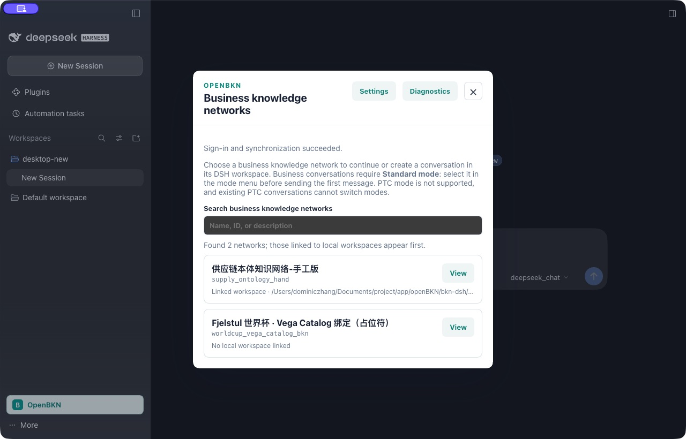

# 第33轮：保留正式平台与真实过期登录恢复

日期：2026-10-21，Asia/Taipei。本轮沿用第32轮本地插件-25，不改插件实现或产物，不部署、不提交、不推送、不跑CI。

用户已明确决定：**“保持当前正式0.2.0，暂不替换”**。两个安全回补候选只保留在本地，不再作为待用户决定的部署步骤。当前平台仍为官方0.2.0；第32轮记录的安全缺陷仍然存在，并未因登录恢复而解决。可能调用Sandbox的完整G6/Desktop模型回合继续待验，未通过删工具或改写答案替代。

## 本次真实登录恢复

- 登录前，正式CLI的`auth status --json`显示`expired=true`，新版真实Desktop显示登录入口；这次没有使用第32轮受控CLI保持进程的fixture。
- 从同一新版Desktop的“Sign in and sync with OpenBKN CLI”发起登录，按用户此前授权使用computer use完成本机HTTPS登录。现有管理员凭据只在对应登录表单使用，没有重置、落入报告或输出。
- 浏览器显示授权成功；CLI复验`expired=false`，实际列网返回`supply_ontology_hand`和`worldcup_vega_catalog_bkn`两个网络。
- 同一Desktop显示“Sign-in and synchronization succeeded.”与两个网络；`desktop-new`工作区绑定保留。Host监听进程仍为33047，未重启。
- 新版工作区在第32轮已通过原生入口和公开绑定Remote完成，无需用户再选择已超时的系统窗口。该插件选择器本身的交互缺口仍保留。

这完成了实际过期后的登录和同步恢复，不等于原始长时B1或完整G6通过。本轮没有发起模型或Sandbox回合。

## 保留与验收边界

只读复核两个Deployment的完整spec和UID与第32轮部署前快照一致；Sandbox执行聚合仍为670条，其中395条含非空token字段，未读取其值，未新增Sandbox执行。个人全局DSH五个配置/凭据文件摘要保持一致；默认OpenBKN CLI登录按授权刷新。-25 tgz摘要仍为`ec33b3ff3776b28a939a12e7c8b822bfa2878e812db13edd3a0db59794a25d63`。

证据见[state-check.json](./state-check.json)、[实际过期前Desktop状态](./desktop-real-expired-before.txt)和[恢复后Desktop状态](./desktop-reauth-success.txt)。第32轮的源码、包、双宿主和UI验证保持为[此前结果](../2026-10-21-local-32/RESULTS.md)，本轮不重复执行或冒充新的测试结果。业务数据全量保留检查仍引用第32轮，本轮只进行登录、列网及只读状态核对。

完整合同仍未通过；旧销售明细失败、低权限暂缺、CE非空原生解释、Desktop模型G6、Windows、原始长时B1、SDK安全门槛和最终固定CI候选等仍开放。正式平台安全回补的部署决定已经答复，后续接手不得把本次答复当作部署授权或再次等待同一确认。
