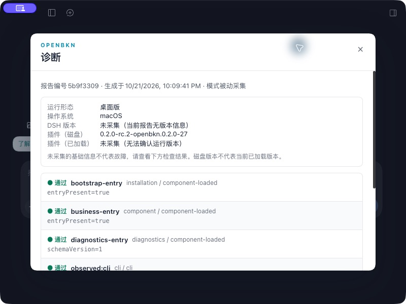

# 第34轮：原样正式0.2.0、B1生命周期、原生目录与诊断可读性

日期：2026-10-21，Asia/Taipei。**当前未发布本地-27包含已复现的MCP配置生命周期、原生目录和诊断深色可读性修复。本轮可在本机完成且不依赖Sandbox的Desktop、登录/UI及有边界B1验证已完成；完整合同仍未通过。** 平台保持官方0.2.0，没有替换两个安全候选，没有真实模型G6或Sandbox执行，没有提交、推送或CI。当前无需用户再选择目录或重新登录。

## 固定身份与验证层次

- 分支 `feat/021-localization-login`，HEAD仍为 `933b0ab251c75461ece1ada6145a9487e7eb04d1`，本轮实现和文档保留本地。
- 本地包 `0.2.0-rc.2-openbkn.0.2.0-27`，229683字节、82文件，SHA256 `5a24a54fa327f04c79884b8303d44d0b2f0bae69e844169c31d28a69af832aef`。这是本地开发产物；最新远端build-only候选仍为-12。见 [当前候选身份](./candidate-27.json)。
- 同一tgz通过两版官方Desktop自带CLI安装到任务独立home，82个交付文件一致；个人应用和个人profile未改。固定两版官方Cordis/DSH依赖和旧生成器，不修改官方Host。见 [当前安装核对](./desktop-install-27.json)。最终官方依赖闭包分别为280/297个DSH包、Cordis4.0.4/4.0.5，无混版或分裂Cordis；[旧版闭包](./0.2.0-rc.2/closure-27.json)、[新版闭包](./0.2.1-rc.2/closure-27.json)及[两应用严格签名复核](./desktop-signature-final.json)均通过。
- 两源码基线各607项中606 pass、0 fail、1 Windows-only skip；类型检查、仓库66项、82文件包审计和同包双宿主六组受控检查通过。评测器7项沿用本轮-26的未变更源码结果。见 [当前验证摘要](./local-checks-27.json)和 [当前受控宿主报告](./controlled-hosts-27.json)。受控平台/协议驱动不代表真实模型验收。
- 本轮先形成-26，完成原生目录、登录和B1；视觉复核后再形成-27。与-26逐文件比较，-27只改变`lib/client.js`和`package.json`，Host后端/Remote及其余交付文件逐字节一致；源码仅诊断底板前景色和对应对比度回归变更。B1、目录与登录结果明确属于-26，作为未受影响边界保留；-27重新运行构建/源码/类型/包/双宿主受控，并在两版实际Desktop冷启动复验受影响诊断UI。-26的 [原候选身份](./candidate.json)、[原检查](./local-checks.json)和失败均保留。
- 保留初次失败：认证测试fixture绕过构造函数，补齐其ownerContext后通过；runtime清单版本改为-26而产物名遗漏为-25，3项仓库测试失败，修正清单后66项通过。后者不在插件tgz内，冻结包未改。没有修改测试期望来容纳生产生命周期错误。

## B1：原生Desktop失败、生产回归与本机复验

原运行中的新版Desktop Host PID33047已持续4小时以上。默认CLI登录、目录和任务凭据引用均核对正常，但原生 `bkn_start_interaction` 仍失败：`Public.Unauthorized` / `token is invalid`，业务查询没有发出。真实浏览器重新登录后、同一Host新Session仍复现。错误原文和轨迹保存在 [原生失败截图](./0.2.1-rc.2/b1-native-unauthorized.jpg)、[AX记录](./0.2.1-rc.2/b1-native-unauthorized.txt)、[失败摘要](./b1-before-fix-summary.json)；不把没有明确状态码的这个错误另写成HTTP401。

已确认的机制是原生Cordis Service调用视图把 `this.ctx` 绑定到调用方root。插件延迟创建MCP管理器时使用了这个上下文，MCP子组件因此越过business配置owner的销毁继续存活；新配置看到既有发布工具时可能保留旧连接。两版官方Desktop内置Node/Cordis探针都证明：调用方ctx挂载的子组件在owner销毁后仍有1个，构造时owner挂载的则为0。见 [旧版原生上下文](./0.2.0-rc.2/context-owner.json)、[新版原生上下文](./0.2.1-rc.2/context-owner.json)及 [探针源码](./probes/context-owner.cjs)。

生产回归使用真实Cordis、`OpenBknBusinessContextService`、ToolRuntime和MCP客户端，只有平台是本地合成JSON-RPC服务。原代码在“旧MCP工具随业务owner销毁”断言上失败；修复后通过，替换owner重新握手使用新的合成凭据。见 [修复前失败](./native-owner-before.log)、[修复后通过](./native-owner-after.log)和 [回归源码](../../../packages/openbkn-business-context/tests/mcp-native-owner.test.ts)。生产修复只保存构造时owner context并用于管理MCP子组件，没有增加全局接管、自动重启或凭据轮换。

同-26产物在两版官方原生Desktop重新验证：

| Host | 同一进程 | 配置重载与真实重新登录 | 新Session标准查询 |
|---|---|---|---|
| 0.2.0-rc.2 | PID56680，前后未重启 | 实际UI保存两次；实际UI等待、超时后重试，computer use完成浏览器登录 | 前后均40；平台仅记录 `query_object_instance` |
| 0.2.1-rc.2 | PID56681，前后未重启 | 通过Host公开原生配置编辑器保存两次、公开登录service发起；computer use完成浏览器登录 | 前后均40；平台仅记录 `query_object_instance` |

见 [修复后分宿主摘要](./b1-after-fix-summary.json)、[平台操作核对](./b1-platform-operations.json)、[旧版UI同进程状态](./0.2.0-rc.2/b1-live-26-state.json)、[新版原生登录状态](./0.2.1-rc.2/native-browser-login-26.json)。完整before/after Session和Interaction ID均保留在对应JSON。

工具选择由 [本地回环协议驱动](./probes/protocol-driver.py)发出，实际Session、Agent、ToolRuntime、MCP和平台查询均在真实Host上运行；驱动不使用远程模型，不执行Sandbox，不判断业务答案。**这是已复现配置生命周期路径的修复与有边界复验；不证明原始历史长时问题的所有触发条件都已消除，也不关闭模型G6。** 新版公开API的保存/登录不替代其按钮、键盘验收。

## Desktop目录、登录与UI

旧插件使用Host系统脚本目录选择器，窗口未暴露给computer use。两版官方Desktop实际提供与原生工作区相同的preload目录桥。当前适配优先复用该桥，浏览器/无桥时保留公开Host选择器；取消或异常均不另开第二个窗口。桥接、fallback、取消和失败四项回归通过，源码见 [目录适配](../../../packages/openbkn-business-context/src/client/pick-workspace-directory.ts)和 [测试](../../../packages/openbkn-business-context/tests/pick-workspace-directory.test.ts)。

两版-26均在实际插件“查看→新建工作区”入口完成原生窗口取消、重试、选择独立任务目录，绑定Worldcup并显示业务会话入口：旧版为 `release/local-34/workspaces/native-picker-old`，新版为 `native-picker-new`。没有用绑定API代替选择器交互，既有Supply工作区保留。见 [旧版原生选择结果](./0.2.0-rc.2/native-picker-session-26.jpg)、[新版原生选择结果](./0.2.1-rc.2/native-picker-session-26.jpg)。两版Tab/Shift-Tab循环、Escape返回入口、800×600和原生诊断键盘导出均实际检查；正文可读性另按下节保留失败并在-27修复。见 [旧版焦点](./0.2.0-rc.2/focus-26.json)、[新版焦点](./0.2.1-rc.2/focus-26.json)。诊断中的Host/已加载插件版本仍为未采集，不能用磁盘版本假填；安装、冷启动和新行为另行证明产物身份。

两版实际UI以受控CLI等待fixture验证取消与默认120000ms超时，均核对原Host登录子进程已退出；随后fixture切为真实CLI `exec`透传，computer use完成实际浏览器登录，两网同步成功，再从实际UI恢复正式CLI路径。采样的“从fixture启动起已过秒数”不是取消回收延迟，不把fixture称为正式CLI自然超时。见旧版 [取消](./0.2.0-rc.2/login-cancel-process-26.json)/[超时](./0.2.0-rc.2/login-timeout-process-26.json)/[恢复](./0.2.0-rc.2/final-network-26.jpg)，新版 [取消](./0.2.1-rc.2/login-cancel-process-26.json)/[超时](./0.2.1-rc.2/login-timeout-process-26.json)/[真实恢复](./0.2.1-rc.2/login-real-retry-success-26.jpg)。新版另有一次实际CLI重试因浏览器操作晚于Host期限而超时，浏览器随后完成授权；该记录 [保留原状](./0.2.1-rc.2/login-real-retry-late-26.txt)，再次及时登录成功，不改写成第一次即成功。

新版-26一度出现自动化可读而输入不生效。请求用户置前后，本机进一步通过原生菜单正常退出并重开任务应用，交互恢复，随后完成上列目录、登录和中英文复核；**无需用户继续操作**。原来的 [待验画面](./0.2.1-rc.2/ui-input-pending-26.jpg)保留为过程证据，见 [UI恢复重开记录](./0.2.1-rc.2/ui-recovery-restart-26.json)。重开发生在PID56681的B1前后证据完成之后，不能冒充B1同进程步骤。窄窗口下原生AX曾将可见控件误报offscreen，改用已观察截图坐标操作成功；这属于自动化限制，未据此改产品。

## -27：诊断白底浅字的实际缺陷与复验

在旧版英文视觉复核中，诊断标题、版本值和检查项ID几乎不可见；回看新版原图也有相同问题。诊断底板为白色，但没有自身前景色，继承深色Host浅字。实际失败见 [旧版原图](./0.2.0-rc.2/diagnostics-contrast-before-27.jpg)、[新版原图](./0.2.1-rc.2/diagnostics-narrow-en-26.jpg)。此前键盘/导出成功不等于正文可读，不把这些截图追认为可读性通过。

已有深色Host关闭控件回归只检查了glyph；现补正常正文对比度至少4.5:1的断言，原实现 [确实失败](./diagnostics-contrast-before-27.log)。生产修复仅为诊断白底设置`color: #172033`，与其他插件弹层一致，不改报告事实或导出行为。两版源码全量通过后冻结-27，并在两版官方Desktop重新冷启动、检查英文/中文、800×600正文滚动、键盘循环和NSSavePanel实际JSON保存。见 [最终UI矩阵](./ui-final-27.json)、[旧版JSON](./0.2.0-rc.2/OpenBKN-diagnostic-20261021T140507093Z-0962696a.json)、[新版JSON](./0.2.1-rc.2/OpenBKN-diagnostic-20261021T140828530Z-2833b2a4.json)。

这完成本轮实际复验范围内的本机UI问题；诊断未采集的Host/loaded版本继续如实显示，非空业务溯源及其完整人工联动仍是独立未完成项。

## 平台、数据与剩余合同

平台保持 `https://192.168.50.129`、官方0.2.0。两个服务完整Deployment spec、UID和generation与第32轮部署前完全一致；安全候选没有替换。Sandbox执行聚合仍670条，395条含非空token字段、8种不同值、最大存储代码65514字节，与基线一致；只取聚合，没有读取/导出token值或测试其有效性。见 [平台保留检查](./platform-after-check.json)。[最终镜像身份核对](./formal-running-images-final.json)另覆盖24个原基线容器，镜像ID全部一致，23个运行容器Ready，迁移容器保持Succeeded/exit0。

12张原始业务表共78635行的全行摘要、10张选定业务配置表、用户已有preflight.py修改均与第31轮保留基线一致；个人DSH五个配置/凭据文件摘要未变，默认CLI `expired=false`。见 [业务数据保留](./preservation-check.json)和 [个人配置保留](./personal-config-preservation.json)。两份任务独立profile的临时协议provider均已移除，原patch逐字节恢复，实际刷新的CLI/MCP引用、测试会话和Worldcup目录绑定保留；两任务应用正常退出，回环协议服务停止，安装保留-27。见 [最终清理核对](./cleanup-final.json)。

上游复核到DSH `687f282e`、Foundry `d9ae3594`，正式版本仍v0.2.0；与第32轮已核对上游相比新增的两提交仅涉及Vega错误字段和Catalog配置保留，未发现本插件消费的MCP/CLI/Sandbox合同变化。见 [上游检查](./upstream-refresh.json)与 [增量范围](./upstream-delta.json)。这不授权升级pin或部署。

G6逐题依赖、低权限缺口、旧销售明细失败与非Sandbox待验项单列在 [G6-BLOCKERS.md](./G6-BLOCKERS.md)。CE非空原生解释、真实Desktop模型、Windows、完整人工矩阵、SDK安全决策和最终固定CI候选继续开放。保持用户“不替换正式平台、全部收敛前不推送不跑CI”的要求；不能把本地源码/协议驱动通过当成正式发布验收。
